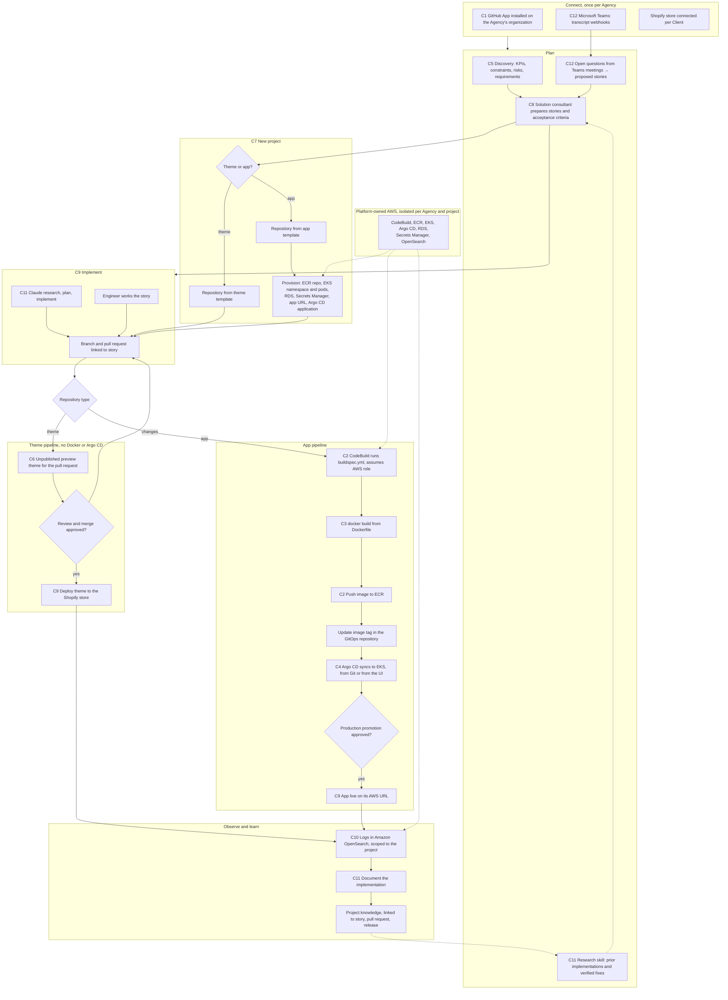

# End-to-end capability flow

Status: aligned 20 October 2026. Locks are in [alignment.md](alignment.md). Phase placement is in [phase-plan.md](phase-plan.md).

Capabilities are tagged C1–C12 in the order they were listed. The same flow applies whether the tenant is an agency or a brand acting as its own Agency. All AWS infrastructure is owned and operated by the platform. Agencies connect GitHub, Microsoft Teams (meeting transcripts), and their Clients' Shopify stores.

| Phase | Capabilities |
| --- | --- |
| 1 Foundation | C1, C5, C8 |
| 2 Build and deploy | C2, C3, C4, C6, C9, C10 |
| 3 Provisioning | C7 |
| 4 AI workflow | C11, C12 |

| Tag | Capability |
| --- | --- |
| C1 | Connect GitHub |
| C2 | Authenticate to AWS from `buildspec.yml` and push images to ECR |
| C3 | Build the image from the repository `Dockerfile` |
| C4 | Deploy to EKS through Argo CD, from Git or from the UI |
| C5 | Discovery with KPIs |
| C6 | Shopify preview theme from a pull request |
| C7 | New repository from GitHub that provisions the app URL, RDS, pods, Secrets Manager entries, and related infrastructure |
| C8 | Solution consultants prepare stories |
| C9 | Build a theme or an app, then deploy the theme to Shopify or the app to AWS |
| C10 | View logs in Amazon OpenSearch |
| C11 | Claude skills for research, plan, implement, and documenting previous implementations |
| C12 | Connect Microsoft Teams and create stories from unanswered meeting questions |

## What is needed to start development

These are the accounts, access, and tools the development team (including the AI coding agent) needs. They are ordered by the phase that first needs them, so Phase 1 can start before AWS is fully set up.

Two kinds of account are involved. **Platform accounts** belong to the company building this product and host it. **Test tenant accounts** stand in for an Agency and its Clients so the product can be tested end to end. Keep them separate from the start, even if the same person owns both.

### Phase 1 — needed now

| Item | What to create | Why |
| --- | --- | --- |
| GitHub organization for the platform | An organization (not a personal account) that owns this product's source code | Code, pull requests, CI, and ownership that is not tied to one person |
| Product repository | A private repository in that organization, for example `higgsden-platform` | The modular monolith and these docs |
| GitHub App, development | A GitHub App registered under the platform organization, read-only: metadata and pull requests, with webhooks enabled | C1. Needs the App id, private key, webhook secret, and client id and secret for sign-in |
| GitHub test organization | A second organization acting as a test Agency, with one or two sample repositories | Installing the App the way a customer would, and testing Agency isolation |
| Domain | A domain for the product, plus a development subdomain | Sign-in callbacks, webhook URLs, and later app URLs |
| Webhook tunnel for local development | A tunnel such as ngrok or Cloudflare Tunnel | GitHub must reach a local machine to deliver webhooks |
| PostgreSQL | Local PostgreSQL 16 or later for development | Primary datastore |
| Email sending | None locally, the Docker Compose mail catcher is enough. Amazon SES from task 4 | Invites and sign-in |
| Stripe account | Test mode is enough | Plans, trials, and subscription states |
| GitHub OAuth app | An OAuth app under the platform organization, separate from the GitHub App | "Sign in with GitHub" through Better Auth |
| Google Cloud project | An OAuth client in a Google Cloud project, with the consent screen set up | "Sign in with Google" through Better Auth |
| Sentry | An organization with projects for web, api, and worker | Error reporting wired in task 1 |

### Phase 2 — build and deploy

| Item | What to create | Why |
| --- | --- | --- |
| AWS Organization | A management account with AWS Organizations and IAM Identity Center for human sign-in | No long-lived IAM user keys. Separate accounts can be added per environment |
| AWS hosting account | One account under the organization that hosts the platform and every Agency's apps, plus a recommended sandbox account for platform development | Shared hosting, with experiments kept away from paying Clients |
| AWS region | One primary region, for example `ap-south-1` or `us-east-1` | Every resource and quota is regional |
| Service quotas | Check EKS, EC2 vCPU, Elastic IP, and CodeBuild concurrency limits in the chosen region | New accounts start with low limits |
| AWS budgets and billing alerts | A budget per account with email alerts | EKS, RDS, and OpenSearch cost money from the first hour |
| Shopify Partner account | A Partner organization for the platform | Development stores and Shopify app registration |
| Shopify development stores | At least two: one as a test Client theme store, one as a test app install target | C6 preview themes and C9 theme deploys |
| Theme access for the test store | A theme access password from the Theme Access app, or an Admin API token with theme read and write scope | Shopify CLI theme pushes from the pipeline |
| A sample theme repository | Based on Dawn or a client-like theme, in the GitHub test organization | Proves the theme pipeline on an existing repository |
| A sample app repository | A small Shopify app with a `Dockerfile` and `buildspec.yml`, in the GitHub test organization | Proves the CodeBuild, ECR, and Argo CD pipeline on an existing repository |
| GitHub App permission increase | Add commit statuses or checks, pull-request comments, and contents read | Preview links and build results on pull requests |

### Phase 3 — provisioning

| Item | What to create | Why |
| --- | --- | --- |
| Route 53 hosted zone | A zone for the app subdomain, for example `apps.<product-domain>` | C7 app URLs |
| TLS | AWS Certificate Manager in the chosen region | HTTPS for hosted apps |
| Infrastructure-as-code state | An S3 bucket per account for Terraform state, with lockfile locking | Repeatable base infrastructure |
| Crossplane | Crossplane and its AWS provider on the hosting cluster, with an IAM role it can assume | Per-project resources through GitOps |
| Template repositories | Theme template and app template repositories in the platform organization | C7 starting points |
| GitHub App permission increase | Administration (repository creation) and contents write | Creating repositories in an Agency's organization |

### Phase 4 — AI workflow

| Item | What to create | Why |
| --- | --- | --- |
| Anthropic API account | An organization with a workspace per environment, API keys, and spend limits | C11 Claude skills |
| Microsoft Entra app | Multi-tenant app with `OnlineMeetingTranscript.Read.All` and `OnlineMeetings.Read.All`, admin consent | C12 Teams transcripts |
| Microsoft 365 test tenant | Teams enabled, Graph transcript access and speaker attribution on, application access policy granted to a test organizer | C12 end-to-end against real Graph |
| Webhook tunnel for Graph | Same public HTTPS URL used for GitHub, plus `/api/webhooks/teams/transcripts` | Graph change notifications cannot reach localhost |
| Usage alerting | Spend limits on the Anthropic workspace | Cost control per environment |

### Local tools on the development machine

Checked on 20 October 2026:

| Tool | Status |
| --- | --- |
| Git | Installed, 2.53 |
| GitHub CLI | Installed, 2.38, signed in as `braveenaajay`. Upgrade recommended, this version is from 2023 |
| Node.js | Installed, 22 |
| pnpm | Installed, 9.15 |
| Docker | Installed, 24.0 |
| Shopify CLI | Installed, 4.3 |
| PostgreSQL client | Installed, 14.18. Server should be 16 or later |
| kubectl | Installed, 1.27. Upgrade to match the EKS version before Phase 2 |
| Python | Installed, 3.13 |
| uv | Not installed. Needed for the embedding service |
| Redis | Not installed locally. Run it in Docker Compose instead |
| AWS CLI v2 | Not installed. Needed from Phase 2 |
| Terraform | Not installed. Needed from Phase 2 for base infrastructure |
| Webhook tunnel | Not checked. Needed for Phase 1 GitHub webhooks |

### How to share access safely

- Do not paste secrets, private keys, or tokens into chat or commit them. Put them in a local `.env` file that is listed in `.gitignore`, or in a secrets manager.
- For AWS, sign in through IAM Identity Center with `aws configure sso`. The agent then uses the named profile, and no access keys are shared.
- For GitHub, the existing `gh` sign-in is enough for repository work. The GitHub App private key is downloaded once and kept as a file outside the repository.
- For Shopify, add the development team as staff on the Partner organization rather than sharing one login.
- For Microsoft Teams, keep the Entra app client secret and resource-data certificate outside the repository. Agency consent is done in the Agency tenant, never with a shared login.
- Give the development account least privilege. Production AWS and live Shopify stores are not needed until Phase 2 promotion is being tested.

### Decisions needed before Phase 1 code starts

- Product name for the GitHub organization, repository, and domain.
- Primary AWS region, so Phase 2 does not have to move anything.

The stack itself is decided in [tech-stack.md](tech-stack.md).
