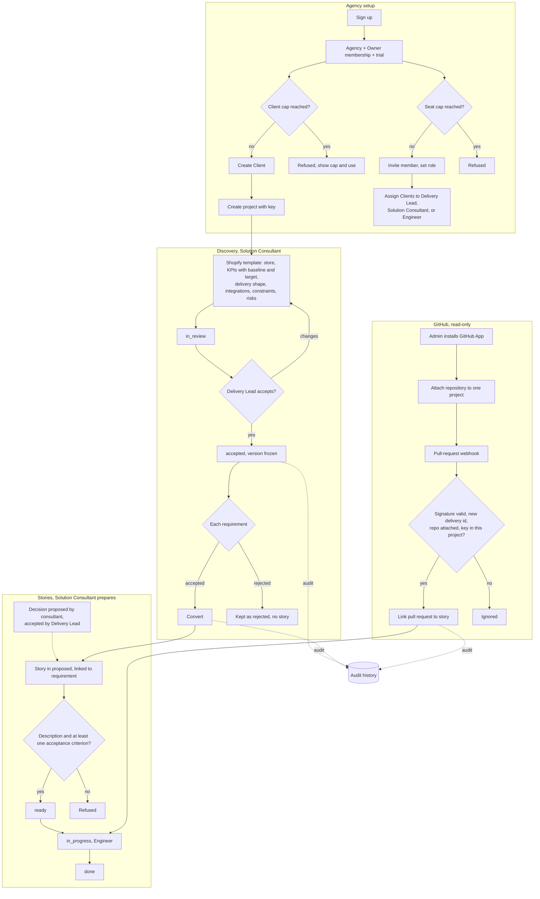
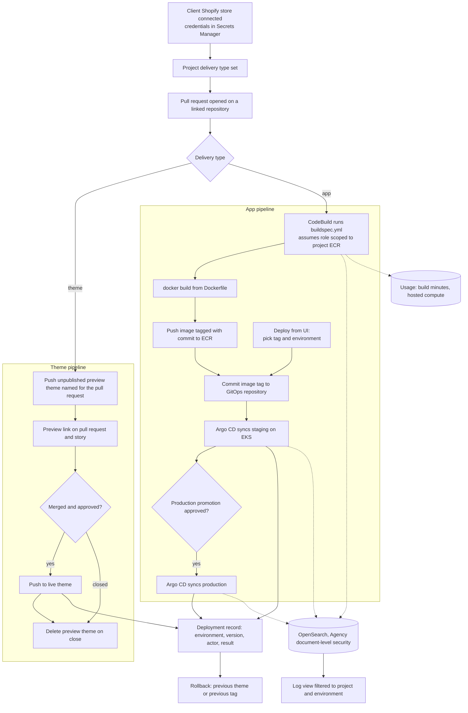
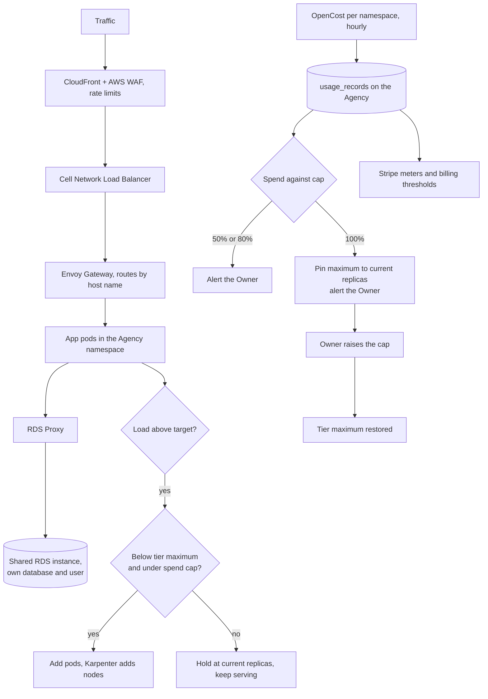
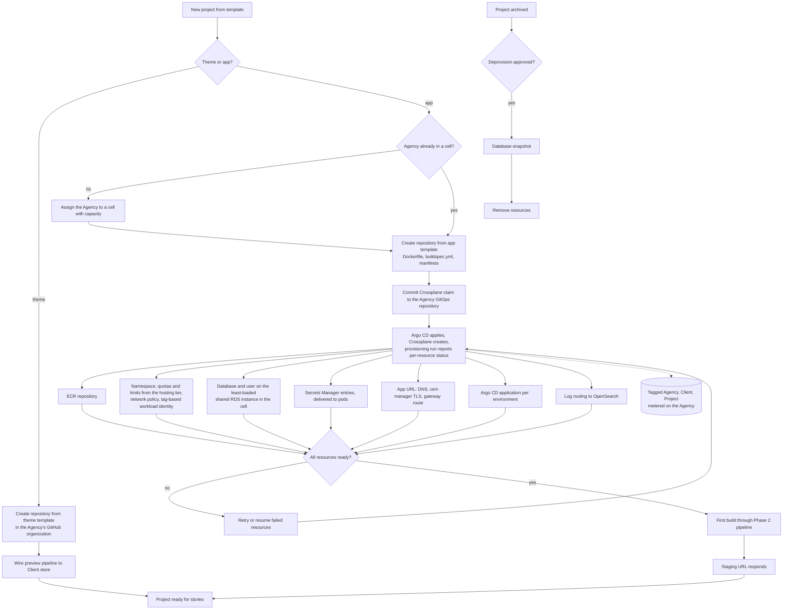
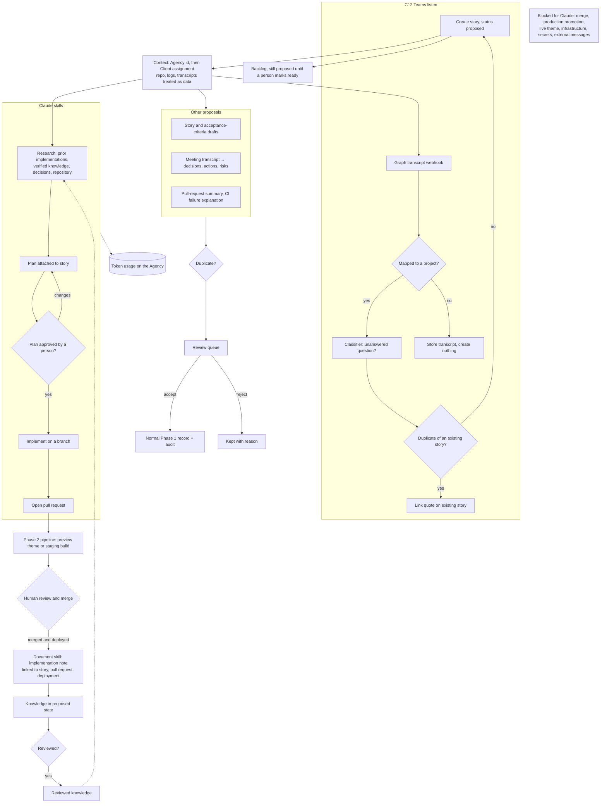
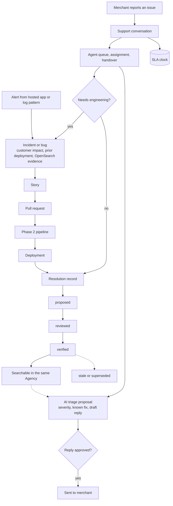
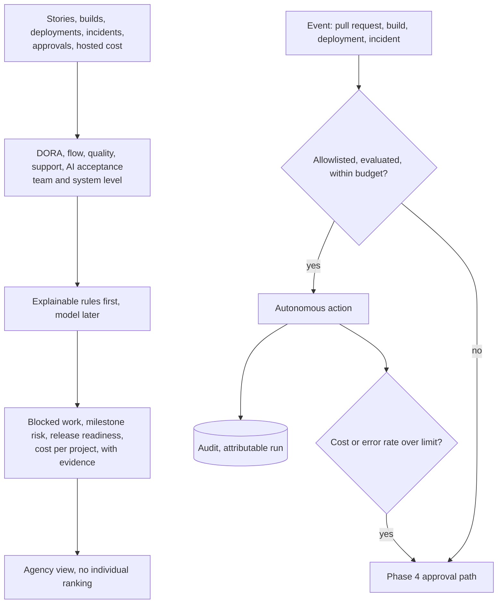

# Phase flows

Parent: [alignment.md](alignment.md). Phase 1 follows [phase-1-foundation.md](phase-1-foundation.md). Phases 2–6 follow the outlines in [phase-plan.md](phase-plan.md) and will change when those documents are written. The single end-to-end view is [capability-flow.md](capability-flow.md).

Every flow runs inside one Agency. Agency id is checked first, then Client assignment, on every read, search, webhook, pipeline, log view, and AI context.

## How the phases connect

```mermaid
flowchart LR
    P1["1 Foundation<br/>discovery → stories → pull request"]
    P2["2 Build and deploy<br/>preview themes, ECR, Argo CD, logs"]
    P3["3 Provisioning<br/>template → repo + infrastructure"]
    P4["4 AI workflow<br/>Claude skills + Teams questions → stories"]
    P5["5 Support and operations<br/>merchant issue → verified fix"]
    P6["6 Intelligence and autonomy<br/>evidence-backed risk, allowlisted actions"]

    P1 -- "stories linked to pull requests" --> P2
    P2 -- "proven pipelines" --> P3
    P3 -- "platform-controlled repos and environments" --> P4
    P4 -- "proposals, approvals, implementation notes" --> P5
    P5 -- "deployments, incidents, recovery times" --> P6
    P6 -. "actions outside the allowlist" .-> P4
```

## Phase 1 — Foundation

## Phase 2 — Build and deploy

### Hosting, scaling, and spend in Phase 2

## Phase 3 — Provisioning

## Phase 4 — AI workflow

## Phase 5 — Support and operations

## Phase 6 — Intelligence and autonomy

