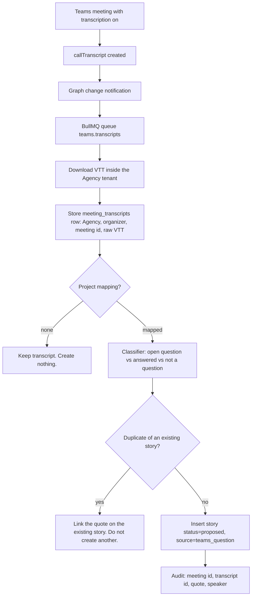

# Microsoft Teams integration

Status: planned 20 October 2026. Database slice done (tables, RLS, dummy seed, isolation tests).
Parent: [alignment.md](alignment.md). Phase: 4 (AI workflow). Capability: C12.
Related: [phase-plan.md](phase-plan.md), [capability-flow.md](capability-flow.md), [tech-stack.md](tech-stack.md).

## Goal

An Agency connects its Microsoft 365 tenant. HiggsDEN listens for Teams meeting transcripts. After each meeting, unanswered **open questions** become **stories** on the mapped project backlog.

That is the whole product idea. Everything below is what Microsoft actually allows, and how we keep Agency isolation.

## What “listen” means

Microsoft Graph does not give a live audio tap of a Teams call. A meeting bot that joins the call and streams media exists, but it is a restricted Real-time Media product, separate consent, and a different security model. It is out of scope for this plan.

The supported listen path is:

1. Transcription is on for the meeting (organizer or tenant policy).
2. Teams writes a `callTranscript` when transcription produces an artifact — usually when the meeting ends, sometimes earlier if transcription is saved mid-call.
3. Graph sends a **change notification** (`created`) to HiggsDEN.
4. HiggsDEN downloads the transcript, classifies open questions, and creates stories.

If the webhook is missed, a periodic **delta query** on `getAllTranscripts` catches up.

The Graph subscription must exist **before transcription starts**. Connecting Teams after a meeting cannot invent a transcript for that meeting.

Channel meetings and live events are not supported by `getAllTranscripts`. v1 covers scheduled calendar meetings (the join URL on the invite), not private channel meetings.

## One-sentence contract

```
Teams tenant (Agency) → transcript webhook → open questions → stories on one Project
```

A story is the task. New stories start as `proposed` so they appear on the backlog immediately, and a Solution Consultant or Delivery Lead still marks them ready before engineering.

## Connect, once per Agency

Same pattern as GitHub: a **platform-owned multi-tenant Entra app**, installed on the Agency’s Microsoft 365 tenant by an Admin or Owner.

| Step | Who | What |
| --- | --- | --- |
| 1 | Platform | Register one Entra application. Application permissions only (see below). Admin consent in each Agency tenant. |
| 2 | Agency Admin | In HiggsDEN: **Connect Microsoft Teams**. Signs in, consents, stores the tenant id against the Agency. |
| 3 | Agency Admin | Maps **meeting organizers** (Entra user ids) and optional **subject prefixes** to a Client + Project. Unmapped meetings are stored, then ignored — no story is created. |
| 4 | Agency’s Teams admin | Enable Graph transcript access (off by default since 31 July 2026). Enable speaker attribution. Grant a Teams **application access policy** for the HiggsDEN app to the organizer users (or `-Global`). |
| 5 | Platform worker | Create a Graph subscription on `communications/onlineMeetings/getAllTranscripts` for that tenant. Renew it before expiry. |

Dummy mode (until the Entra app and a test tenant exist): the Agency page shows **Mode: fake**, same as GitHub. A “Simulate meeting transcript” button posts a fixture with two open questions and creates two `proposed` stories. Isolation tests use two Agencies; Agency B never sees Agency A’s simulated questions.

## Microsoft requirements (locked by Graph)

Researched against Microsoft Graph v1.0 and Teams admin docs, October 2026.

**Permissions (application, admin consent):**

- `OnlineMeetingTranscript.Read.All` — list and download transcripts.
- `OnlineMeetings.Read.All` — resolve the meeting (subject, join URL, organizer) so we can map it to a project.
- `Calendars.Read` (optional, later) — match subject/time when the join URL is the new `/meet/` format.

Delegated permissions are not enough for tenant-wide listen. `getAllTranscripts` is application-only.

**Tenant toggles (Agency’s Teams admin, not HiggsDEN):**

```powershell
Set-CsTeamsMeetingConfiguration -EnableGraphTranscriptAccess $true -EnableAttributedTranscripts $true -Identity Global
New-CsApplicationAccessPolicy -Identity HiggsDEN-meetings -AppIds "<platform-app-id>" -Description "HiggsDEN meeting transcripts"
Grant-CsApplicationAccessPolicy -PolicyName HiggsDEN-meetings -Identity "<organizer-user-object-id>"
# or: Grant-CsApplicationAccessPolicy -PolicyName HiggsDEN-meetings -Global
```

If Graph transcript access is off, every content request returns `403` with `GraphAccessToTranscriptsDisabled`. Application access policy alone is not enough.

If speaker attribution is off, request `Accept: application/vnd.microsoft.graph.transcript+text` instead of `text/vtt`. Classification still runs; speaker names are omitted.

**Webhook:**

```http
POST https://graph.microsoft.com/v1.0/subscriptions
{
  "changeType": "created",
  "resource": "communications/onlineMeetings/getAllTranscripts",
  "notificationUrl": "https://<public-url>/api/webhooks/teams/transcripts",
  "lifecycleNotificationUrl": "https://<public-url>/api/webhooks/teams/lifecycle",
  "expirationDateTime": "<now+max>",
  "clientState": "<per-agency secret>",
  "includeResourceData": true
}
```

Validate the Graph validation token as plain text. Verify `clientState`. Encrypted resource data needs a certificate the platform rotates. Subscriptions expire; a BullMQ job renews them.

**Transcript content:**

```http
GET /users/{organizerId}/onlineMeetings/{meetingId}/transcripts/{transcriptId}/content
Accept: text/vtt
```

VTT is timestamped utterances with `<v Speaker>` tags when attribution is on.

**Catch-up:**

```http
GET /users/{organizerId}/onlineMeetings/getAllTranscripts(meetingOrganizerUserId='{organizerId}')
```

Then follow `@odata.deltaLink`. Do not re-apply filters on the delta link.

## Runtime flow



All Graph calls, queue jobs, and inserts run with the Agency id set first. Transcripts never enter another Agency’s search or backlog.

## What counts as an open question

The classifier is a versioned Claude skill (`skill.meeting_open_questions`), not a chat. It receives only:

- Meeting subject and time
- The VTT (or unattributed text)
- Titles of open stories on that project (for duplicates)

It returns a JSON list. Each item:

| Field | Rule |
| --- | --- |
| `question` | The unanswered question in one sentence |
| `quote` | Exact transcript span |
| `speaker` | Display name if the VTT has it, else null |
| `assigneeHint` | Name mentioned as owner, else null |
| `confidence` | 0–1. Below 0.7 is dropped. |
| `duplicateOfKey` | Existing story key, or null |

**Open** means the transcript never answers it. “Should we use Checkout Extensibility?” followed by “Yes, Checkout Extensibility only” is **not** created. “Who owns the size guide copy?” with no answer **is** created.

The skill may not send email, post to Teams, or call any write tool except `stories.create_from_question` on the mapped project.

Until Claude is connected, a deterministic dummy classifier tags lines that end with `?` and are not followed by an answer in the next two utterances. That is enough for e2e.

## Task shape

Each accepted open question becomes a `stories` row:

- `title` — the question, shortened to 120 characters
- `description` — quote, speaker, meeting subject, time, transcript id
- `status` — `proposed`
- `key` — next project key (`ACME-7`, …)
- epic — `Meeting questions` on that project, created once if missing

Acceptance criterion written automatically:

> Given the meeting transcript, when this question is resolved, the answer is recorded on the story.

No story is marked `ready`. Ready still requires a person (existing backlog rule: acceptance criteria plus any linked decision).

## Mapping meetings to projects

An Admin configures one or more rules, first match wins:

1. Organizer Entra user → default Project
2. Subject starts with `[ACME]` or a Client name → that Client’s active project
3. Calendar group / Teams user list labelled in HiggsDEN as that project’s delivery team

If nothing matches: store the transcript, show it on the Teams page as **Unmapped**, no stories. An Admin can map it after the fact and re-run classification.

## Isolation and data

Done in PostgreSQL (Docker Compose `postgres`, migration `0003_teams.sql`). Same RLS as GitHub: `agency_id = app_agency_id()`. Graph notifications look up the Agency with `resolve_teams_tenant(entra_tenant_id)` (security definer, returns only the id). Operators see `teams_connected` on `operator_agency_overview()` and have no grant on transcripts or questions.

| Table | What it holds |
| --- | --- |
| `teams_connections` | One row per Agency. Entra tenant id, mode (`fake` \| `graph`), subscription, encrypted `clientState` |
| `teams_organizers` | Entra user ids the Agency can map |
| `teams_project_maps` | Organizer or subject-prefix → Client + Project. Unique per organizer / prefix |
| `meeting_transcripts` | Raw VTT. Client and project nullable until mapped. Unique `(agency_id, graph_transcript_id)` |
| `meeting_questions` | Quote, speaker, confidence, link to the created story. Unique `(transcript_id, quote)` |

`stories.source` is `teams_question` when the row came from a meeting. `stories.source_ref` stores the Graph transcript id.

Learning rules still apply: the transcript is **data**, not instructions. Embeddings, if we index the meeting later, stay inside the Agency and the assigned Client.

HiggsDEN never posts back into Teams in v1 (alignment: skills may not send external messages).

## Dummy data until accounts exist

Same rule as GitHub and Stripe. The database seed loads the platform catalog only (plans, tiers, cell, templates). Tenant Teams rows are created through the API, not the seed.

| Fixture | Result |
| --- | --- |
| Agency connects in `Mode: fake` and maps an organizer | Connection + maps present |
| Simulated discovery call, two unanswered questions | Two `proposed` stories, epic Meeting questions, `source=teams_question` |
| Same Graph transcript id posted twice | Unique index rejects the second row |
| Meeting with no project map | Transcript stored, no stories |
| Operator console | `Teams connected` on the Agency, no quotes |

## Out of scope for v1

- Joining the live call as a bot
- Channel meetings and webinars
- Writing to Teams chat or creating Teams tasks in Microsoft To Do
- Recording video/audio files
- Using one Agency’s meetings as training data for another
- Auto-marking stories ready

## Implementation slices

0. **Database — done.** Tables, RLS, `resolve_teams_tenant`, dummy seed, isolation tests against Docker Postgres.
1. **Connection page** under Agency → Teams. Dummy install, organizer list, project maps, Mode: fake, Simulate transcript.
2. **Webhook + queue** with signature/`clientState` checks, idempotent on Graph transcript id.
3. **Classifier + story insert** with duplicate detection (existing word-set helper in `packages/domain`). Writes to the tables already in this schema.
4. **Graph adapter** behind the same interface as the dummy: subscribe, download VTT, list organizers.
5. **Playwright** — connect dummy Teams, simulate meeting, assert two stories; isolation user does not see them.

Place this work in Phase 4 next to the other drafting skills. The GitHub App stays C1. Teams does not replace it.

## Accounts needed (platform)

| Item | Why |
| --- | --- |
| Multi-tenant Entra app (platform) | Agency admin consent. Application permissions above. |
| Redirect URI on the public URL | Admin consent callback |
| Webhook HTTPS URL | Graph change notifications |
| Certificate for encrypted resource data | `includeResourceData` notifications |
| Test Microsoft 365 tenant with Teams | End-to-end against real Graph |
| Teams admin on that tenant | Transcript API toggle, speaker attribution, application access policy |
| One test user who organizes meetings | `getAllTranscripts` is per organizer |

Until those exist, ship dummy mode only. Do not block other Phase 4 work on a Microsoft tenant.
